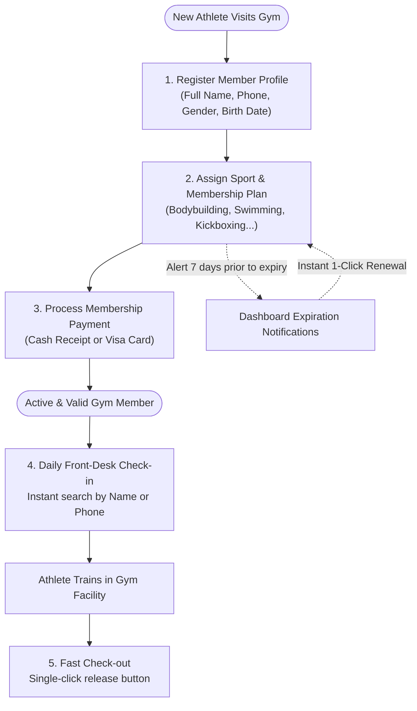

# 🏋️‍♂️ AI Gym Management System | Comprehensive Overview & Guide
### EL-Halawany GYM - Smart Gym & Fitness Center Management Software

> **Language Selector:**  
> 🇸🇦 [**عرض النسخة العربية (SYSTEM_OVERVIEW.md)**](./SYSTEM_OVERVIEW.md)

---

A modern, comprehensive, and intelligent web application purpose-built for gyms, fitness clubs, and sports centers. It combines rapid front-desk check-in speeds (under 3 seconds), zero-data-loss local persistence, and proactive automated guardrails to eliminate common human errors.

---

## 📑 Table of Contents
1. [🌟 Vision & Core Objectives](#-vision--core-objectives)
2. [🔄 Daily Gym Workflow](#-daily-gym-workflow)
3. [🖥️ Core Modules & Application Screens](#️-core-modules--application-screens)
   - [1. Central Command Dashboard](#1-central-command-dashboard)
   - [2. Member Directory & 360° Profiles](#2-member-directory--360-profiles)
   - [3. Attendance & Front-Desk Station](#3-attendance--front-desk-station)
   - [4. Subscription & Plan Management](#4-subscription--plan-management)
   - [5. Financial Ledger & Payments](#5-financial-ledger--payments)
   - [6. Admin Settings, Sports & Data Backups](#6-admin-settings-sports--data-backups)
4. [🛡️ Smart Features & Defensive Guardrails](#️-smart-features--defensive-guardrails)
5. [⚙️ Technical Architecture & Tech Stack](#️-technical-architecture--tech-stack)
6. [🚀 Quick Start & Development Setup](#-quick-start--development-setup)

---

## 🌟 Vision & Core Objectives

Traditional fitness centers frequently struggle with manual paper logs, slow spreadsheets, and unrecorded memberships. **AI Gym System** delivers:
- **Instant Front-Desk Check-Ins:** Check in returning athletes in **under 3 seconds**.
- **Automated Expiration & Overlap Guards:** Prohibits duplicate memberships for the same sport or overlapping dates.
- **Duplicate Attendance Defense:** Prevents checking in a member twice if they are currently inside the facility.
- **Offline-First Resilience:** Instant reactive updates and complete persistence in structured `LocalStorage`, allowing full operations without requiring an active external database server.

---

## 🔄 Daily Gym Workflow

The diagram below outlines the standard lifecycle of gym members and everyday front-desk interactions:



---

## 🖥️ Core Modules & Application Screens

### 1. Central Command Dashboard
The control hub for gym owners and shift managers:
* **Hero Quick-Action Commands:** 4 high-contrast athletic action buttons:
  - 🟢 **Quick Check-in:** Instant popup to check in members with live membership verification.
  - 🔵 **New Member:** Streamlined modal to register a new athlete profile.
  - 🟣 **New Subscription:** Assign a plan with automatic end-date calculation.
  - 🔘 **Record Payment:** Generate financial receipts linked to existing subscriptions.
* **Real-time KPI Metrics:**
  - Total registered athletes in the database.
  - Currently active memberships.
  - Memberships expiring soon (within 7 days).
  - Today's collected revenue counter.
* **Subscription Distribution Matrix:** Visual status breakdown (Active, Expiring Soon, Upcoming, Expired).
* **Live In-Gym Stream:** Real-time roster of athletes currently working out inside the facility, their arrival timestamps, and instant checkout triggers.

---

### 2. Member Directory & 360° Profiles
Full management of the gym's community:
* **Dual-Field Search & Filter:** Instant filtering by full name or phone number, with active vs. archived toggles.
* **Member 360° Profile Dialog:**
  1. **Personal Identity:** Name, phone, age, join date, dynamic avatar, and health/fitness notes.
  2. **Subscriptions Tab:** Chronological history of all plans, live statuses, and quick renewal shortcuts.
  3. **Attendance History Tab:** Full log of session dates, check-in/out hours, and total workout frequency.
  4. **Financial Ledger Tab:** Complete receipt history, paid amounts, payment methods, and notes.
  5. **Weekly Training Schedule:** Day-of-week workout plan and sport mapping.
  6. **Body Composition Tracking:** Historical body weight (kg) and measurement progression logs.

---

### 3. Attendance & Front-Desk Station
Designed for maximum speed and zero friction during peak gym hours:
* **Dual-Search Dropdown:** Real-time query matching across both member name and phone number simultaneously.
* **Live Status Preview Card:** Displays immediate feedback upon selecting a member (shows green if valid, yellow warning if already inside, or red alert if expired).
* **Activity Game Chips:** Select the sport(s) being practiced today (auto-selected based on active subscription).
* **Live Headcount Badge:** Pulsing indicator showing exact number of athletes currently inside.
* **End-of-Day Bulk Checkout:** One-click utility to check out all remaining members at the end of the shift.

---

### 4. Subscription & Plan Management
Precise control over member agreements and training periods:
* **Duration Options:**
  - **Monthly:** 1 Calendar Month.
  - **Quarterly:** 3 Calendar Months.
  - **Yearly:** 12 Calendar Months.
* **Automated Date Mathematics:** Automatically computes the correct expiration date when selecting start date and plan type.
* **Color-Coded Status System:**
  - 🟢 **Active:** Currently valid for facility entry.
  - 🟡 **Expiring Soon:** 7 days or less remaining.
  - 🔵 **Upcoming:** Scheduled to begin in a future period.
  - 🔴 **Expired:** Terminated and requires renewal.

---

### 5. Financial Ledger & Payments
Transparent revenue tracking:
* Revenue breakdowns: Today's Intake, Current Month Total, and Lifetime Gym Revenue.
* Comprehensive receipt records: Member Name, Sport, Date, Payment Method (Cash / Visa), and Reference Notes.
* Integrated checkout flow: Enables issuing an immediate payment receipt upon creating a subscription.

---

### 6. Admin Settings, Sports & Data Backups
Enterprise-level control and data safety:
* **Sports & Activities Catalog:** Create, edit, and price sports (Bodybuilding, Cardio, Swimming, Kickboxing, CrossFit).
* **Training Sub-Types:** Configure specialized programs per sport.
* **Full Database Backup & Disaster Recovery:**
  - **Export JSON:** Download a complete JSON snapshot of all members, subscriptions, attendance, payments, and schedules.
  - **Import JSON:** Restore the entire database from any backup file with a single click.
  - **Factory Reset:** Re-initialize the system with rich, pre-populated demonstration data.

---

## 🛡️ Smart Features & Defensive Guardrails

| Smart Guardrail | Problem Solved | Technical Implementation |
| :--- | :--- | :--- |
| **Searchable Dual-Filter Dropdown** | Frustrating endless scrolling in standard select menus as membership scales. | PrimeNG `p-dropdown` with `[filter]="true"` and `filterBy="name,phone"` allowing instant retrieval by name or digits. |
| **Anti-Duplicate Check-in** | Receptionist accidentally checking in the same member twice during their workout. | Live status validator verifies whether the member's latest check-in record has `checkOut === null`. Disables duplicate entry with warning. |
| **Subscription Overlap Guard** | Double-charging or creating conflicting date ranges for the same sport. | Automated date-overlap collision algorithms inspect active subscriptions before allowing new creations. |
| **Zero-Data-Loss Persistence** | Power outages, browser crashes, or accidental reloads losing front-desk data. | Synchronous reactive persistence pipeline syncing all state changes to structured `LocalStorage` with schema backups. |
| **Native RTL & Cairo Typography** | Clunky translated UIs with broken icon alignment and awkward text flow. | Purpose-built Arabic-first layout using geometric Cairo typography with exact left/right icon and label buffers. |

---

## ⚙️ Technical Architecture & Tech Stack

```
Ai_Gym_System (Root)
├── src/
│   ├── app/
│   │   ├── components/      # Layout wrapper, Navbar, and Sidebar navigation
│   │   ├── models/          # TypeScript contracts (Member, Subscription, Attendance, Payment...)
│   │   ├── pages/           # Feature views (Dashboard, Members, Attendance, Subscriptions, Payments, Admin)
│   │   └── services/        # GymDataService (Reactive RxJS State Store & LocalStorage engine)
│   ├── assets/              # Static media, icons, and brand graphics
│   └── styles.scss          # Athletic design tokens, Cairo font overrides, and RTL spacing rules
```

### 🧰 Key Technologies:
* **Angular 17:** Standalone component architecture (no legacy `NgModule` overhead) ensuring fast bundle generation and snappy route transitions.
* **PrimeNG 17 & PrimeFlex:** Enterprise UI suite providing robust tables (`p-table`), accessible modals (`p-dialog`), and dropdowns (`p-dropdown`).
* **RxJS State Management:** Reactive single-source-of-truth store utilizing `BehaviorSubject` to broadcast state updates seamlessly across all views.
* **Cairo Typography:** High-legibility Google Cairo typeface with tabular numerals for crystal-clear financial figures.

---

## 🚀 Quick Start & Development Setup

### Prerequisites:
- **[Node.js](https://nodejs.org/)** (v18.x or v20.x LTS recommended).
- Package manager: **npm** or **yarn**.

### Local Development:

1. **Navigate to the project root:**
   ```bash
   cd Ai_Gym_System
   ```

2. **Install dependencies:**
   ```bash
   npm install
   ```

3. **Start the development server:**
   ```bash
   npm start
   # or:
   ng serve
   ```

4. **Access the application:**
   - Open your browser to [http://localhost:4200](http://localhost:4200)

### Production Build:
```bash
npm run build
```
Optimized static bundles will be compiled to `dist/gym-dashboard`, ready for deployment to any static web host or container.

---

> 💡 **Staff Tip:** It is recommended to perform a weekly backup by navigating to **Admin Settings (`/admin`)** and clicking **"Export Backup (JSON)"**.

