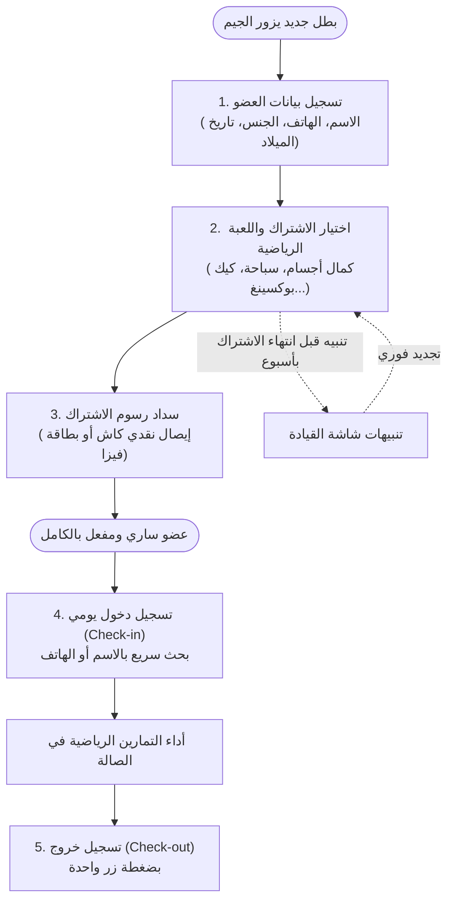

# 🏋️‍♂️ دليل ونظرة عامة على نظام إدارة الجيم | AI Gym System
### جيم الحلواني - EL-Halawany GYM Management System

> **اختيار لغة الدليل / Language Selector:**  
> 🇬🇧 [**Switch to English Version (SYSTEM_OVERVIEW.en.md)**](./SYSTEM_OVERVIEW.en.md)

---

نظام ويب متكامل وذكي، صُمم خصيصاً لإدارة صالات الجيم والأندية الرياضية بكفاءة عالية، يجمع بين سهولة الاستخدام لموظفي الاستقبال والإدارة، والسرعة الفائقة، وتفادي الأخطاء البشرية الشائعة.

---

## 📑 فهرس المحتويات
1. [🌟 فكرة النظام والهدف منه](#-فكرة-النظام-والهدف-منه)
2. [🔄 دورة العمل اليومية في الصالة (Daily Workflow)](#-دورة-العمل-اليومية-في-الصالة-daily-workflow)
3. [🖥️ شاشات وأقسام النظام الأساسية](#️-شاشات-وأقسام-النظام-الأساسية)
   - [1. لوحة القيادة المركزية (Dashboard)](#1-لوحة-القيادة-المركزية-dashboard)
   - [2. سجل إدارة الأبطال (Members)](#2-سجل-إدارة-الأبطال-members)
   - [3. شاشة الحضور والانصراف (Attendance)](#3-شاشة-الحضور-والانصراف-attendance)
   - [4. إدارة الاشتراكات والخطط (Subscriptions)](#4-إدارة-الاشتراكات-والخطط-subscriptions)
   - [5. الخزينة والمدفوعات (Payments)](#5-الخزينة-والمدفوعات-payments)
   - [6. لوحة التحكم والإعدادات (Admin & Backup)](#6-لوحة-التحكم-والإعدادات-admin--backup)
4. [🛡️ المزايا الذكية وحماية الأخطاء (Smart Guardrails)](#️-المزايا-الذكية-وحماية-الأخطاء-smart-guardrails)
5. [⚙️ المعمارية والتقنيات المستخدمة (Technical Architecture)](#️-المعمارية-والتقنيات-المستخدمة-technical-architecture)
6. [🚀 دليل البدء والتشغيل (Quick Start)](#-دليل-البدء-والتشغيل-quick-start)

---

## 🌟 فكرة النظام والهدف منه

يهدف **AI Gym System** إلى حل الفوضى التي تواجهها صالات الجيم اليومية:
- التخلص من الدفاتر الورقية والشيتات المعقدة.
- تسريع عمليات الاستقبال (دخول العضو يستغرق **أقل من 3 ثوانٍ**).
- الحماية الفورية من نسيان تجديد الاشتراكات أو تكرار تسجيل الحضور بالخطأ.
- العمل بشكل فوري ومستقر مع حفظ كامل للبيانات بدون الحاجة لخوادم معقدة في البداية بفضل التخزين التفاعلي الآمن.

---

## 🔄 دورة العمل اليومية في الصالة (Daily Workflow)

يوضح المخطط التالي كيف تدور العمليات في الصالة الرياضية خطوة بخطوة:



---

## 🖥️ شاشات وأقسام النظام الأساسية

### 1. لوحة القيادة المركزية (Dashboard)
مركز التحكم اليومي لمسؤول الصالة وموظف الاستقبال:
* **شريط الإجراءات السريعة (Hero Command):** 4 أزرار وصول مباشر بإطارات ملونة وأيقونات بارزة:
  - 🟢 **حضور سريع:** نافذة منبثقة ذكية لتسجيل دخول أي عضو واختيار الأنشطة في ثوانٍ.
  - 🔵 **عضو جديد:** نافذة تسجيل لاعب جديد.
  - 🟣 **اشتراك جديد:** تفعيل اشتراك مباشر واحتساب تلقائي للتواريخ.
  - 🔘 **تسجيل دفعة:** إضافة إيصال مالي مرتبط باشتراك العضو.
* **بطاقات الأداء الرياضية (KPI Cards):**
  - إجمالي الأبطال المسجلين في الصالة.
  - عدد الأعضاء أصحاب الاشتراكات السارية الآن.
  - عدد الاشتراكات التي ستنتهي قريباً (خلال 7 أيام).
  - إجمالي إيرادات وخزينة اليوم المحصلة.
* **ملخص الاشتراكات التراكمي:** رسم شريطي وتوزيع فوري لحالات الاشتراكات (سارية، تنتهي قريباً، قادمة، منتهية).
* **شريط الحضور المباشر (Live In-Gym Stream):** قائمة متجددة لحظياً بالأعضاء الموجودين داخل الصالة الآن ووقت دخولهم وزر خروج فوري لكل منهم.

---

### 2. سجل إدارة الأبطال (Members)
دليل كامل وتفاعلي لجميع اللاعبين المسجلين:
* **بحث وتصفية ذكية:** إمكانية البحث الفوري بالاسم أو رقم الهاتف، وتصفية الأعضاء الحاليين أو المؤرشفين.
* **الملف التفصيلي الشامل للعضو (Member 360° Profile):** نافذة غنية تشمل:
  1. **البيانات الشخصية:** الاسم، الهاتف، السن، تاريخ الانضمام، الصورة الرمزية، والملاحظات الصحية.
  2. **تبويب الاشتراكات:** كل الاشتراكات السابقة والحالية وحالتها وزر تجديد مباشر.
  3. **تبويب سجل الحضور:** سجل كامل بتواريخ وأوقات دخول وخروج العضو وعدد مرات تواجده.
  4. **تبويب المدفوعات:** أرشيف الإيصالات والمبالغ المسددة وطرق الدفع.
  5. **جدول التدريب الأسبوعي (Weekly Schedule):** الأيام المقررة للتمرين ونوع النشاط.
  6. **سجل القياسات والوزن (Body Weight Tracking):** تتبع تطور وزن العضو وقياساته مع التواريخ.

---

### 3. شاشة الحضور والانصراف (Attendance)
محطة الاستقبال السريعة لتنظيم دخول الصالة:
* **قائمة البحث المنسدلة الذكية:** تدعم البحث المزدوج بالاسم أو برقم الهاتف، مع عرض الصورة الرمزية لكل لاعب.
* **بطاقة المعاينة الفورية (Live Status Preview):** تعرض حالة اشتراك اللاعب فور اختياره (هل اشتراكه سارٍ؟ متى ينتهي؟ أو هل هو منتهٍ وبحاجة للتجديد؟).
* **اختيار ألعاب اليوم (Activity Chips):** تحديد الأنشطة التي سيتدرب عليها في هذه الجلسة.
* **عداد المتواجدين لحظياً:** شارة رقمية متحركة تعرض عدد الأبطال المتدربين داخل الجيم في نفس اللحظة.
* **إنهاء اليوم دفعة واحدة (Bulk Checkout):** زر ذكي بنهاية الشيفت لتسجيل خروج جميع الأعضاء المتبقين دفعة واحدة.

---

### 4. إدارة الاشتراكات والخطط (Subscriptions)
التحكم الكامل في عقود اللاعبين وفترات التدريب:
* **خيارات الخطط الزمنية:**
  - **شهري (Monthly):** شهر واحد.
  - **ربع سنوي (Quarterly):** 3 أشهر.
  - **سنوي (Yearly):** 12 شهراً.
* **احتساب التواريخ آلياً:** بمجرد تحديد تاريخ البداية ونوع الخطة، يحسب النظام تاريخ الانتهاء تلقائياً دون أي تدخل يدوي.
* **تصنيف الحالات بالألوان:**
  - 🟢 **ساري (Active):** صالحة للتدريب الآن.
  - 🟡 **ينتهي قريباً (Expiring):** متبقي أسبوع أو أقل.
  - 🔵 **قادم (Upcoming):** تبدأ في فترة مستقبلية.
  - 🔴 **منتهي (Expired):** انتهت وبحاجة للتجديد.

---

### 5. الخزينة والمدفوعات (Payments)
الدفتر المالي الإلكتروني للصالة:
* إجمالي التحصيل المالي مصنفاً حسب: إيراد اليوم، إيراد الشهر، وإجمالي إيرادات الصالة.
* تفاصيل كل إيصال: اسم العضو، النشاط، التاريخ، طريقة السداد (نقدي / فيزا)، والملاحظات.
* نافذة تحصيل فورية مدمجة بالاشتراكات لضمان عدم وجود اشتراك بدون سند مالي مسجل.

---

### 6. لوحة التحكم والإعدادات (Admin & Backup)
الإدارة المتقدمة وأمان البيانات:
* **إدارة الألعاب والرياضات (Sports & Games):** إضافة وتعديل وتحديد الأسعار الافتراضية لكل رياضة (كمال أجسام، لياقة بدنية وكارديو، سباحة حرة، كيك بوكسينغ، كروس فت).
* **إدارة أنواع التدريب:** تخصيص برامج محددة داخل كل نشاط رياضي.
* **النسخ الاحتياطي التام (Full Database Backup & Restore):**
  - **تصدير (Export):** تنزيل ملف JSON يحتوي على كامل قاعدة بيانات الصالة (أعضاء، اشتراكات، مدفوعات، حضور).
  - **استيراد (Import):** استعادة البيانات من أي ملف نسخ احتياطي بضغطة زر.
  - **إعادة ضبط المصنع (Factory Reset):** إعادة تهيئة البيانات مع بيانات تجريبية افتراضية غنية.

---

## 🛡️ المزايا الذكية وحماية الأخطاء (Smart Guardrails)

| الميزة الذكية | المشكلة التي تعالجها | آلية الحل البرمجية |
| :--- | :--- | :--- |
| **البحث المزدوج (Searchable Dropdown)** | التمرير الطويل والبطيء في القوائم التقليدية مع كثرة المشتركين. | مكوّن `p-dropdown` مهيأ للبحث الفوري بحقلين معاً: اسم اللاعب أو رقم هاتفه. |
| **الوضع المبسط (Simple Mode - Android Style)** | صعوبة استخدام الكمبيوتر والأنظمة المعقدة لدى بعض المدربين غير التقنيين. | واجهة إرشادية بديلة خفيفة بنمط الهواتف الذكية بـ 5 أزرار ضخمة، ومسارات عمل سهلة لا تزيد عن 3 خطوات بدون الحاجة لحفظ أي شيء. |
| **منع الحضور المكرر (Anti-Duplicate Check-in)** | تسجيل دخول نفس اللاعب مرتين بالخطأ أثناء وجوده بالصالة. | فحص فوري للحالة: إذا كان اللاعب داخل الصالة ولم يسجل خروجاً بعد، يُعطل النظام التسجيل المكرر ويظهر تنبيهاً باللون الأصفر. |
| **منع تداخل الاشتراكات (Overlap Guard)** | إنشاء اشتراكين لنفس اللعبة في نفس الفترة الزمنية. | التحقق البرمجي التلقائي من تضارب تواريخ البدء والانتهاء للاشتراكات السارية لنفس الرياضة. |
| **الحفظ التفاعلي بدون فقد بيانات (Zero Data Loss)** | انقطاع التيار الكهربائي أو إغلاق المتصفح فجأة. | مزامنة فورية لكل عملية تعديل أو إضافة داخل الـ `LocalStorage` المشفر والمنظم. |
| **توافق كامل مع العربية (RTL & Cairo)** | تشوه واجهات الأنظمة المترجمة ومشاكل الأيقونات المعكوسة. | تصميم عربي أصيل من الصفر بخط Cairo ذي التباين العالي وأبعاد متناسقة للـ RTL. |

---

## ⚙️ المعمارية والتقنيات المستخدمة (Technical Architecture)

```
Ai_Gym_System (Root)
├── src/
│   ├── app/
│   │   ├── components/      # مكونات التخطيط، الشريط العلوي (Navbar)، والشريط الجانبي (Sidebar)
│   │   ├── models/          # نماذج الـ TypeScript (Member, Subscription, Attendance, Payment...)
│   │   ├── pages/           # صفحات النظام (Dashboard, Members, Attendance, Subscriptions, Payments, Admin)
│   │   └── services/        # GymDataService (مستودع البيانات التفاعلي Reactive State Store)
│   ├── assets/              # الأيقونات والصور والملفات الثابتة
│   └── styles.scss          # التنسيقات العامة والمتغيرات الرياضية والثيم العربي
```

### 🧰 التقنيات البرمجية الأساسية:
* **Angular 17:** اعتماد معمارية المكونات المستقلة (`Standalone Components`) بدون تعقيد الـ NgModules القديمة، مع أداء فائق في التحميل والتنقل.
* **PrimeNG 17 + PrimeFlex:** مكونات الواجهة الرائدة (الجداول الذكية `p-table`، النوافذ `p-dialog`، القوائم المنسدلة `p-dropdown`).
* **RxJS State Management:** إدارة تفاعلية للحالة عبر `BehaviorSubject` لضمان تحديث الأرقام والمؤشرات في جميع الصفحات فور حدوث أي حركة بالصالة.
* **Cairo Typography:** الخط العربي القياسي عالي الوضوح والمقروئية على جميع الشاشات.

---

## 🚀 دليل البدء والتشغيل (Quick Start)

### المتطلبات الأساسية (Prerequisites):
- تثبيت بيئة **[Node.js](https://nodejs.org/)** (الإصدار 18 أو 20 موصى به).
- مثبت الحزم **npm** أو **yarn**.

### خطوات التشغيل المحلي (Run Locally):

1. **الدخول لمجلد المشروع:**
   ```bash
   cd Ai_Gym_System
   ```

2. **تثبيت الاعتماديات:**
   ```bash
   npm install
   ```

3. **تشغيل خادم التطوير:**
   ```bash
   npm start
   # أو:
   ng serve
   ```

4. **فتح النظام في المتصفح:**
   - توجه إلى الرابط: [http://localhost:4200](http://localhost:4200)

### فحص وبناء النسخة الإنتاجية (Production Build):
```bash
npm run build
```
المخرجات تكون جاهزة للنشر الفوري داخل المجلد `dist/gym-dashboard`.

---

> 💡 **نصيحة للمسؤولين:** يمكنك الاحتفاظ بنسخة احتياطية أسبوعية من بيانات الصالة بالتوجه إلى صفحة **الإعدادات (`/admin`)** والضغط على زر **"تصدير نسخة احتياطية (JSON)"**.
